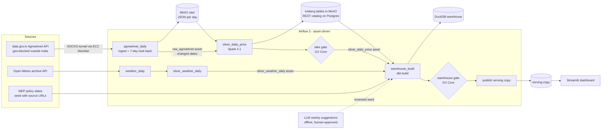

# Basmati Market Lakehouse

A local, reproducible batch lakehouse for Indian mandi (wholesale market) prices, built to
answer one question for a rice trading or procurement team: **how did basmati prices move
around India's Minimum Export Price (MEP) changes in 2023–2024?**

It ingests every commodity Agmarknet reports (all states, about 10–21k rows a day) from
2015 onward, lands raw JSON in object storage, cleans it with Spark into Apache Iceberg,
models it with dbt on DuckDB, gates every layer with data-quality checks, and serves a
Streamlit dashboard. Everything runs on one laptop with `make up`, at $0.

> Status (2026-11-17): every component is built and tested end to end on real data. The
> 2015→2026 backfill is running, and the basmati variety mapping is waiting for human
> review, so the headline numbers and resume metrics below are **pending** until both finish.

## Architecture



| Layer | What | Where |
|---|---|---|
| Raw | one gzipped JSON object + manifest per arrival date, exactly as the API sent it | `s3://lake/raw/agmarknet/dt=YYYY-MM-DD/` |
| Silver | typed, cleaned, repeat reports combined; Iceberg, partitioned by day | `lake.silver.daily_price`, `lake.silver.weather_daily` |
| Warehouse | dbt staging → intermediate → marts (star schema, contracts) | `data/warehouse.duckdb` |
| Serving | copy of the warehouse, published only after the quality gate passes | `data/warehouse_serving.duckdb` |

## How to run

Prerequisites: Docker (Docker Desktop or Colima, ~8 GB RAM for the VM), [uv](https://docs.astral.sh/uv/), Java 17 or 21 (only for the Spark unit tests), and a free [data.gov.in](https://data.gov.in) API key.

```bash
cp .env.example .env              # add DATA_GOV_IN_API_KEY, resource ids, AIRFLOW_JWT_SECRET
make setup                        # local Python env (uv)
make up                           # Postgres, MinIO, Iceberg REST catalog, Airflow 3
make test                         # 37 unit tests (ingestion, Spark transform, mapping, weather)
```

Outside India, start the Mumbai proxy first ([docs/INDIA_PROXY_AWS.md](docs/INDIA_PROXY_AWS.md)) and set `AGMARKNET_PROXY=socks5h://127.0.0.1:1080`.

```bash
make run-day                      # today + 7-day look-back (or DAY=2024-09-13)
make backfill FROM=2015-01-01 TO=2026-11-08
make map-suggest                  # LLM suggestions for unmapped basmati names (needs ANTHROPIC_API_KEY)
#   review review/variety_suggestions.csv: approved = y/n, edit final_* columns
make map-merge && make rebuild-warehouse
make dashboard                    # http://localhost:8501
```

Airflow UI: http://localhost:8080 · MinIO console: http://localhost:9001 · quality reports: `reports/quality/*_latest.md`.

## Data sources

| Source | Use | Notes |
|---|---|---|
| [Agmarknet variety-wise daily prices](https://www.data.gov.in/resource/variety-wise-daily-market-prices-data-commodity) (data.gov.in) | history + daily | 83M rows; Title-case fields, string prices; up to date to the previous day |
| [Agmarknet current daily prices](https://data.gov.in/resource/current-daily-price-various-commodities-various-markets-mandi) | fallback for today | lower-case fields, integer prices |
| [Open-Meteo archive](https://open-meteo.com/en/docs/historical-weather-api) | district weather | free, non-commercial, no key |
| [PIB 27 Aug 2023](https://www.pib.gov.in/PressReleasePage.aspx?PRID=1952629), [PIB 14 Sep 2024](https://www.pib.gov.in/PressReleasePage.aspx?PRID=2054831), news for 26 Oct 2023 | MEP events | Oct 2023 official notice not found yet; marked `official_doc_pending` |
| APEDA / DGCI&S exports | *not yet used* | monthly × country availability unverified ([docs/STEP0_SOURCES.md](docs/STEP0_SOURCES.md)) |

Agmarknet's API exposes **no arrival quantities** and **no price-unit column** (prices are documented as Rs/quintal), so there is no arrivals measure and no unit conversion; see *Issues the checks caught*.

## Versions, and the newer features this uses

| Tool | Version | Feature used |
|---|---|---|
| Airflow | 3.3.2 | **Assets** (data-aware scheduling, asset events carrying the changed dates, an `A \| B` asset expression), the Task SDK, `airflow backfill create` |
| Spark | 4.1.4 | ANSI SQL mode on by default (it caught an invalid-date crash in tests), `try_to_date` / `try_cast` |
| Apache Iceberg | 1.12.0 (runtime), REST catalog 1.10.1 | REST catalog shared by Spark and DuckDB, `overwrite(condition)` atomic replace, schema evolution, time travel |
| dbt-core / dbt-duckdb | 1.12.6 / 1.11.1 | **model contracts**, **unit tests**, YAML snapshots |
| DuckDB | 1.5.6 | `ATTACH ... (TYPE iceberg)` to the REST catalog |
| GX Core | 1.24.1 | GX 1.x API (`ExpectationSuite`, `ValidationDefinition`, `Checkpoint`), Data Docs |
| uv / Ruff | lockfile + 14-day `exclude-newer` cooldown; Ruff lint + format |

Spark is pinned to 4.1, not 4.3: Iceberg 1.12.0 publishes Spark runtimes only for 4.0 and 4.1. dbt now offers a v2; this project stays on dbt-core 1.12.

## Design decisions (short version)

The full list, with rejected alternatives and tradeoffs, is in [docs/DESIGN_DECISIONS.md](docs/DESIGN_DECISIONS.md).

- **Why DuckDB as the warehouse:** columnar and in-process, free, reads Iceberg directly through the REST catalog, and makes CI trivial (the `ci` dbt target attaches a 7-row fixture file as `lake`). Tradeoff: one writer at a time. Asset scheduling serialises dbt runs, and the dashboard reads an atomically published copy, so it never takes the lock.
- **Partitioning:** raw by `dt=` (one object per day, so a re-run is a single atomic PUT); silver by `days(arrival_date)`, sorted by commodity within each partition. Late revisions replace exactly the affected days in one Iceberg commit (`overwrite(condition)`), so readers never see a half-replaced day.
- **Late-arriving data:** each day's content hash is stored in its manifest. Daily runs re-pull 7 days back, and only days whose hash changed are rewritten and passed downstream (in the asset event).
- **SCD2:** `dim_market` from a dbt snapshot of each market's district. Agmarknet has no market codes, so a market is (state, name), and the earliest version is extended back so historical prices still join. History is *observed from the first snapshot onward*, not reconstructed.
- **Spark, honestly:** at roughly 10–20k rows a day, DuckDB alone could do this transform. Spark is here to show the distributed write path (Iceberg commits, partitioning) that would matter at a larger scale.
- **LLM only offline:** the pipeline never calls an LLM. A script proposes structured mappings, a person approves each row, and only approved rows enter the dbt seed.

## Iceberg: time travel and schema evolution (real examples from this build)

The `report_count` column was added to the live `silver.daily_price` table after real data showed repeat reports. In Iceberg that's a metadata-only change:

```sql
ALTER TABLE lake.silver.daily_price ADD COLUMN report_count INT;   -- no data files rewritten

-- snapshots: the first build, a new day, then the rebuild with the new logic
SELECT committed_at, operation, summary['added-records'], summary['deleted-records']
FROM lake.silver.daily_price.snapshots;

-- time travel: the table as it was before the change (report_count reads as NULL)
SELECT count(*), count(report_count)
FROM lake.silver.daily_price VERSION AS OF <first_snapshot_id>;
```

## Issues the checks caught (real, on this data)

- **Repeat reports with different prices.** About 10% of market × commodity × variety × grade keys appear more than once a day (Nov 2026 data), e.g. Paatan APMC green peas at 2150 *and* 2100. The first version kept the highest price, which biases prices up. Silver now combines repeats (lowest min, highest max, mean modal) and records `report_count`.
- **Other units in the Rs/quintal column.** About 0.1–0.25% of rows have modal prices below 10 Rs/quintal, e.g. Delhi roses at 2.33 (typical 13,250) and Tripura fish at 1.0 (typical 12,500): per bunch or per kg. With no unit field there's no safe conversion, so they stay in silver, are excluded in dbt staging, and the GX gate fails if their share passes 1%.
- **Rounding inconsistencies:** a handful of rows where min > modal by under 1 paisa, because the source rounds modal but not min/max. The check uses a 1-paisa tolerance.
- **Invalid dates crash Spark 4.** ANSI mode made `to_date('31/02/2023')` fail the whole job. A unit test caught it; the transform uses `try_to_date`.
- **Unmapped basmati names fail the warehouse gate**, which lists them (e.g. `Rice | Basumathi`, `Rice | Basamti Dawat`), and the dashboard stays on the last good build.

## Measured results

| Metric | Value |
|---|---|
| Rows per day (all commodities, raw) | 7,733 (Sunday) – 21,509 (Nov 2026); ~10.5–10.7k (Jan 2015) |
| Silver transform, 8 days / 124k rows | 14.1 s (Spark local mode, includes JVM start) |
| API throughput (Mumbai proxy) | ~1.05 s per 1,000 rows; page size 5,000 |
| Backfill speed | ~30 s/day with one caller; two concurrent callers after that |
| Data-quality checks | 10 lake checks + 2 warehouse checks per run (GX), 64 dbt tests incl. 3 unit tests |
| Rows ingested in total, years backfilled, markets, varieties mapped | **pending: backfill running** |
| End-to-end daily run, full backfill runtime | **pending** |
| Share of LLM suggestions accepted unchanged | **pending: human review** |
| Headline: basmati price before vs after each MEP change | **pending**, see [RESULTS.md](RESULTS.md) once built |

## Repository layout

```
dags/            Airflow DAGs (ingest, silver, weather, warehouse)
src/basmati/     ingestion client + raw store, Spark transforms, quality gates, config
dbt/             staging / intermediate / marts, seeds, snapshot, unit tests
dashboard/       Streamlit app
scripts/         proxy, source probe, LLM variety mapping, CI fixture builder
docker/          Airflow (+ Spark jars, analytics venv), MinIO from source, Iceberg REST
docs/            source verification (Step 0), design decisions, proxy setup
```
